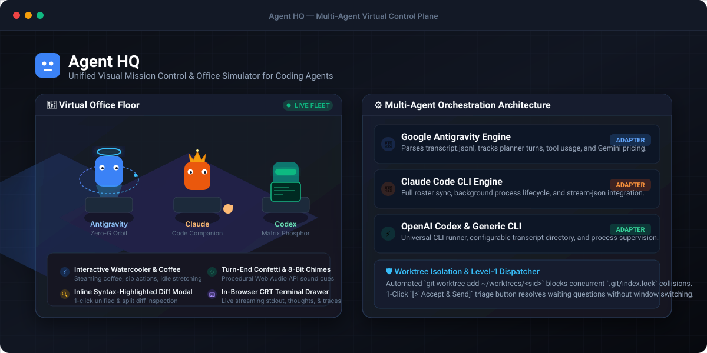

# Agent HQ

**Agent HQ** is a local-first control plane and animated visual office simulator for AI coding agents. It unifies **Google Antigravity**, **Claude Code**, and **OpenAI Codex** sessions into a single retro-styled dashboard.

Agents sit at desks in rooms organized by repository, show real-time tool executions, celebrate turn completions, and can be steered or inspected without leaving your browser.

<p align="center">
  
</p>

---

## Key Capabilities

### 1. Multi-Agent Ecosystem Support
* **Google Antigravity:** Ingests `transcript.jsonl` logs, tracking planner responses, tools (`swarm`, `run_command`, `read_file`), and Gemini token pricing.
* **Claude Code:** Full backward compatibility with local session transcripts, background roster management, and CLI resume/stop actions.
* **OpenAI Codex & Generic CLI:** Not working yet. The Codex adapter reads a flat folder and an older record shape, so it finds none of the current `sessions/YYYY/MM/DD/rollout-*.jsonl` files, and Agent HQ cannot send to or stop Codex or Antigravity sessions (those actions now say so instead of reporting success). See `research/2026-11-23-agent-hq-improvement-research-report.md`.

### 2. Animated Virtual Office
* **Harness Visuals:**
  * **Antigravity:** Zero-gravity floating animations with celestial orbit glow and holographic tablet props.
  * **Codex:** Emerald cybernetic scanner visor and retro phosphor CRT matrix screens.
  * **Claude:** Royal crown accents, wagging companion pet, and classic notebook prop.
* **Office Dynamics:** Steaming coffee mugs with sipping actions, typing sparks, idle stretching, pacing during tool runs, and turn-completion confetti.
* **Atmospheric Lighting:** Smooth dynamic transitions across day, dawn, dusk, and night.

### 3. Integrated Developer Workflow
* **8-Bit Retro Audio Engine:** Zero-dependency procedural Web Audio API cues for turn completions, attention requests, and warnings (with top-bar mute toggle).
* **Inline Syntax-Highlighted Git Diff Modal:** Inspect modified files (`+N / -N`) directly from an agent's desk in unified or side-by-side view.
* **Git Worktree Isolation:** Launch agents in isolated `git worktree` environments (`~/worktrees/<sid>`) to prevent `.git/index.lock` collisions.
* **In-Browser CRT Terminal Drawer:** View streaming agent stdout, thoughts, and tool traces in real time.
* **Level-1 Actionable Triage (shadow mode):** Review drafted answers in the "Needs You" tray and send one with a click or `Ctrl+Enter`. Each draft is sent once; if drafting fails repeatedly (for example `claude` is not logged in) the dispatcher pauses itself and says why.
* **Universal Sharding & Broadcast:** Use `/distribute` to fan out tasks across agents or `@all` to broadcast instructions to active workers.

---

## Quickstart

### Prerequisites
* Node.js (v18+)
* Git

### Launching the Dashboard

```bash
# Start Agent HQ in an app window (binds to http://127.0.0.1:7787)
node agent-dashboard.js --open
```

### Running Tests

```bash
# Run the automated test suite (about 250 checks). It writes only to a temporary folder, and checks
# that need real sessions on your machine are skipped when there are none.
node run-tests.js
```

---

## Architecture Overview

```text
agent-hq/
├── agent-dashboard.js        # Main local HTTP & Server-Sent Events server
├── worktrees.js              # Git worktree lifecycle: create, merge (tests the merge result), prune, cleanup
├── detectors.js              # Repeat-call and repeat-failure detectors (pure functions)
├── dispatcher.js             # Autonomous triage and draft generation
├── dispatcher-policy.json    # Policy rules for safe auto-triage
├── adapters/
│   ├── base.js               # Common adapter interface
│   ├── antigravity.js        # Google Antigravity transcript adapter
│   ├── claude.js             # Claude Code session adapter
│   ├── codex.js              # Generic / OpenAI Codex adapter
│   └── index.js              # Unified multi-agent registry & router
└── agents-ui/
    ├── world.html            # Main virtual office interface
    ├── alerts.js             # 8-bit procedural sound synthesizer
    ├── tray.js               # "Needs You" attention drawer & 1-click approvals
    ├── perf.js               # Fleet telemetry, costs, and KPI panels
    └── timeline.js           # Multi-agent turn execution swimlanes
```

---

## Security & Privacy

* **Strict Localhost Binding:** The dashboard server binds only to `127.0.0.1` with Host header validation to prevent local network exposure.
* **Read-Only Transcript Observation:** Existing agent sessions are observed through disk logs; actions are dispatched exclusively via sanctioned CLI entrypoints.
* **Untrusted Data Isolation:** Prompts and agent outputs are isolated within policy guardrails.
* **Control Endpoints Need A Token:** Every state-changing request needs the per-run page token (or the value in `.state/local-api-token` for scripts and hooks on this machine) and a same-origin request. Read endpoints such as `/api/state` are open to anything that can reach `127.0.0.1:7787`.
* **Remote Approval Links:** Signed with a random per-install secret in `.state/webhook-secret` (or `AGENT_DISPATCH_WEBHOOK_SECRET`), valid for 15 minutes, usable once, and they open a confirmation page: only the button on that page acts.
* **Loop Alerts Are Hints:** `detectors.js` labels repeated identical calls or repeated identical failures within one turn. Nothing kills, restarts or types into a session because of an alert.
